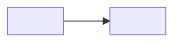

# <Product name> — brief

15 words a sentence. Living doc: it states the product as it is today. Rewrite in place.

## What it is

<One paragraph: what it does, who it is for, why it matters.>

## What good looks like

- <A sentence the user would say when the product works.>

## Hard rules

Things that must be exact, or must never happen. Each one is code, with a test.

- <rule> — <why it matters>

## Building blocks

The blocks the product is built from, and how they connect. Only what runs today.

- A block runs or stores on its own: an app, a server, a data store, an agent, an outside service.
- Screens, files, and functions inside one block are not blocks.
- An arrow is a connection. Label it with what moves along it.
- Use the user's words for every label.
- At most 12 blocks. Past that, group blocks into one.
- No block built yet? Write "None yet."

- <block> — <its one job>

## Agent abilities

Only when the product has its own AI agent. Delete this section otherwise.

### <Ability name>

Goal: <what the agent achieves, in the user's words>
Tools: <what it can use>
Instructions: <path to the prompt or skill file>

Scenarios:

- <real input> → <what a good result looks like>

## Not doing

- <what the product will not do, and why>

## Settled choices

- <choice> — <reason>, round <n>

## How to run

<The command that starts the product, and how to open it.>

## How to ship

Push: <remote and branch>, or none
Deploy: <the command or service that puts it live>, or none
Live: <the link or place to see it>, or none
